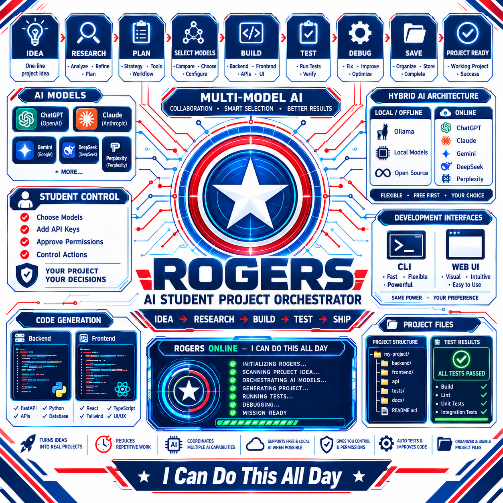

 <p align="center">
  
</p>

<h1 align="center">ROGERS — AI Student Project Orchestrator</h1>

<p align="center">
  <strong>IDEA → RESEARCH → BUILD → TEST → SHIP</strong>
</p>

<p align="center">
  An intelligent AI-powered platform that transforms a student's project idea into a complete, tested, and organized software project.
</p>

---

## 🚀 About ROGERS

ROGERS is an AI Student Project Orchestrator designed to help college students turn a one-line project idea into a practical, working software project.

It researches and refines ideas, recommends suitable AI tools, coordinates multiple AI models, generates backend and frontend code, automatically tests and debugs the project, and saves the completed result to the student's selected project folder.

## ✨ Key Features

- 💡 **Idea to Project** — Transform a one-line idea into a complete project.
- 🔎 **AI Research** — Research, analyze, and refine project concepts.
- 🤖 **Smart AI Recommendations** — Compare suitable free and paid AI tools.
- 🧠 **Multi-Model Collaboration** — Coordinate multiple AI models when suitable.
- 🔐 **Human Approval** — Keep students in control of model selection, permissions, and important actions.
- ⚙️ **Complete Project Generation** — Build backend, frontend, APIs, and supporting files.
- 🧪 **Automatic Testing** — Verify that the generated project works.
- 🛠️ **Debugging and Repair** — Detect errors and attempt fixes.
- 📁 **Project File Management** — Organize and save completed project files.
- 🌐 **Hybrid AI Architecture** — Support local/offline and online AI providers.
- 💻 **CLI and Web Interface** — Offer flexible development workflows.

## 🔄 Project Workflow

```text
IDEA → RESEARCH → PLAN → SELECT MODELS
     → BUILD → TEST → DEBUG → SAVE
     → PROJECT READY
```

## 🎯 Mission

Help students move beyond a simple idea and develop real, usable software through AI-powered research, engineering, testing, and automation.

<p align="center">
  <strong>“I Can Do This All Day”</strong>
</p>

# 🛡️ ROGERS

### AI Project Orchestration Engine for Students

> **Give ROGERS one project idea. Build it step by step.**

ROGERS is an open-source AI project orchestration engine designed for college students and developers.

The goal is simple:

**Turn a project idea into a structured, technically sound, runnable project — with AI assistance and human control at every important stage.**

ROGERS is inspired by the mission-briefing experience of **Captain America / Steve Rogers**: focused, persistent, team-oriented, and built to keep moving forward.

---

## 🎯 Vision

A student should not need to know everything before starting a project.

They should be able to describe an idea and let ROGERS help them move through:

```text
Project Idea
     ↓
Research & Analysis
     ↓
Requirements
     ↓
Architecture
     ↓
Technology Stack
     ↓
Development Roadmap
     ↓
Human Approval
     ↓
Runnable Project Scaffold
     ↓
Feature Implementation
     ↓
Testing
```

The long-term goal is to make ROGERS capable of orchestrating the entire software-development lifecycle while keeping the developer in control.

---

# 🛡️ Current Status

ROGERS is actively under development.

### Completed

- [x] Project creation from an idea
- [x] Structured project blueprint generation
- [x] Research & analysis stage
- [x] Requirements engineering stage
- [x] System architecture stage
- [x] Technology stack stage
- [x] Development roadmap stage
- [x] Human approval workflow
- [x] Modify stage decisions
- [x] Regenerate stages with guidance
- [x] Downstream context propagation
- [x] Persistent project storage
- [x] Multi-project management
- [x] Project scaffolding
- [x] JSON and Markdown blueprint export
- [x] Provider abstraction
- [x] Automated test suite
- [x] FastAPI backend
- [x] React + TypeScript frontend
- [x] Blueprint → real feature implementation (Slice 3)
- [x] Sandboxed path security & pre-modification snapshot backups
- [x] Automated bytecode/syntax compilation validation
- [x] Visual before/after diff viewer & one-click rollback
- [x] Implementation → Test → Debug → Verify pipeline (Slice 4)
- [x] Sandboxed test execution runner (`pytest`)
- [x] AI failure analysis & root-cause diagnosis
- [x] Bounded self-healing repair loop (`MAX_REPAIR_ATTEMPTS = 3`)
- [x] Captain America Mission Control UI/UX with concentric shield progress indicator
- [x] Verifiable defense architecture checks & chronological mission telemetry log

### 🚧 In Development

- [ ] GitHub integration & Git commits (Slice 5)
- [ ] Plugin system
- [ ] Intelligent model/provider routing
- [ ] Multi-agent execution
- [ ] Deployment automation

---

# 🤖 AI Orchestration

ROGERS is designed around specialized AI roles rather than forcing one model to perform every task.

The long-term mission structure is:

| Mission     | Role                    | Example Providers        |
| ----------- | ----------------------- | ------------------------ |
| 🕵️ Recon    | Research & intelligence | Perplexity, Groq, Ollama |
| 🔥 Backend  | Backend engineering     | Claude, OpenAI, Ollama   |
| ⚡ Frontend | Frontend engineering    | OpenAI, Ollama           |
| 🛡️ Testing  | Testing & verification  | DeepSeek, Ollama         |

The provider layer is intentionally flexible.

Users should be able to choose the models they want instead of being locked into a single AI provider.

---

# 🧠 Human-in-the-Loop

ROGERS does not blindly execute every AI decision.

Important stages can be reviewed and modified by the developer.

For example:

```text
AI recommends PostgreSQL
        ↓
Developer reviews
        ↓
Developer changes it to SQLite
        ↓
ROGERS updates downstream decisions
        ↓
Architecture and roadmap adapt
```

This keeps the developer in control of the project.

---

# 🏗️ Architecture

Current technology stack:

### Backend

- Python 3.10+
- FastAPI
- Pydantic
- Uvicorn
- JSON-based persistent project storage

### Frontend

- React
- TypeScript
- Vite
- Tailwind CSS
- Lucide Icons

### AI Providers

- Built-in offline provider
- Groq
- OpenAI
- Ollama
- OpenAI-compatible endpoints

### Testing

- Pytest

---

# 📁 Project Structure

```text
ROGERS/
│
├── backend/
│   ├── app/
│   │   ├── models.py
│   │   ├── storage.py
│   │   ├── orchestrator.py
│   │   ├── scaffolder.py
│   │   ├── implementation/
│   │   │   ├── models.py
│   │   │   └── service.py
│   │   ├── main.py
│   │   ├── providers/
│   │   └── routes/
│   │
│   └── requirements.txt
│
├── frontend/
│   ├── src/
│   │   ├── api/
│   │   ├── components/
│   │   │   ├── TaskImplementationModal.tsx
│   │   │   ├── BlueprintView.tsx
│   │   │   └── ...
│   │   ├── App.tsx
│   │   └── types.ts
│   └── dist/
│
├── generated_projects/
│
├── tests/
│   ├── test_backend.py
│   ├── test_multi_stage.py
│   ├── test_implementation.py
│   ├── test_slice4.py
│   ├── test_slice5.py
│   └── test_frontend_serving.py
│
├── verify_slice1.py
├── verify_slice2.py
├── verify_slice3.py
├── verify_slice4.py
├── verify_slice5.py
├── run.py
├── README.md
├── LICENSE
└── .gitignore
```

---

# 🚀 Running ROGERS Locally

## 1. Clone the repository

```bash
git clone https://github.com/YOUR_USERNAME/ROGERS.git
cd ROGERS
```

## 2. Create the Python environment

### Windows

```powershell
python -m venv .venv
```

Activate it:

```powershell
.\.venv\Scripts\Activate.ps1
```

## 3. Install backend dependencies

```powershell
pip install -r backend\requirements.txt
```

## 4. Configure environment variables

Create a local `.env` file:

```env
GROQ_API_KEY=
OPENAI_API_KEY=
ANTHROPIC_API_KEY=
PERPLEXITY_API_KEY=
```

API keys are optional depending on the provider being used.

**Never commit your `.env` file to GitHub.**

## 5. Start ROGERS

```powershell
python run.py
```

Then open:

```text
http://127.0.0.1:8000
```

---

# 🔐 Security

ROGERS follows a **Bring Your Own Key (BYOK)** approach.

API keys should:

- Stay on the user's machine
- Be stored locally in `.env`
- Never be committed to Git
- Never be displayed in logs
- Never be stored by a ROGERS server

Example:

```text
.env
```

is private.

```text
.env.example
```

can safely be committed.

---

# 🧪 Testing

Run the test suite:

```powershell
pytest tests/ -v
```

The current test suite covers:

- Health checks
- Provider detection
- Input validation
- Complete blueprint generation
- Domain adaptation
- SPA serving
- Multi-stage orchestration
- Human modification
- Downstream context propagation
- Project scaffolding
- Path security & sandbox traversal prevention
- Pre-modification snapshots and restoration
- Allowlisted compilation validation runner
- End-to-end task implementation pipeline
- Sandboxed test execution runner (`pytest`)
- Structured failure analysis & root-cause diagnosis
- Bounded self-healing repair loop (max 3 attempts)
- Verified vs completed status distinction
- Secure packaging verification gates & secret sanitization
- Cryptographic SHA-256 artifact integrity hashing
- Package streaming download & embedded verification reporting
- Comprehensive Final Mission Report dossier generation

Run the slice verification scripts:

```powershell
python verify_slice1.py
python verify_slice2.py
python verify_slice3.py
python verify_slice4.py
python verify_slice5.py
```

---

# 🛡️ ROGERS Design Philosophy

ROGERS should feel less like a generic enterprise dashboard and more like a **mission-control system**.

The interface direction is inspired by:

- 🛡️ Shield geometry
- ⭐ Star motifs
- 🔵 Deep blue command-center surfaces
- 🔴 Red mission indicators
- ⚪ White/silver information elements
- 🎬 Cinematic orchestration
- 🤖 AI agents working as a team

The mission execution interface features a **Captain America-inspired concentric shield circular progress indicator**, tactical stepper, and unified mission delivery dashboard.

The goal is:

> **A Captain America mission briefing × futuristic AI command center × developer workstation.**

---

# 🗺️ Roadmap

## Phase 1 — Foundation (Slice 1 & 2)

- [x] Project creation
- [x] Blueprint generation
- [x] Multi-stage orchestration
- [x] Human review
- [x] Persistent project memory
- [x] Project scaffolding

## Phase 2 — Implementation (Slice 3)

- [x] Select development task
- [x] Generate implementation
- [x] Modify project files safely (sandboxed path validation)
- [x] Pre-modification snapshots & one-click rollback
- [x] Validate generated code (allowlisted compilation check)
- [x] Display implementation results with visual diff viewer

## Phase 3 — Verification (Slice 4)

- [x] Automated test runner (`pytest`) with project-root containment
- [x] Failure detection & structured diagnosis
- [x] Bounded self-healing repair loop (`MAX_REPAIR_ATTEMPTS = 3`)
- [x] Truthful verification status (`verified` only with test evidence)
- [x] Captain America Mission Control UI/UX & shield progress indicator

## Phase 4 — Mission Control & End-to-End Delivery (Slice 5)

- [x] Unified End-to-End Pipeline (Blueprint → Scaffold → Verify → Package → Report)
- [x] Packaging verification gate (blocks unverified or broken projects)
- [x] Secret & artifact sanitization (excludes `.env`, `.git`, `.venv`, `__pycache__`)
- [x] Embedded verification report (`VERIFICATION_REPORT.md` inside archive)
- [x] Cryptographic SHA-256 artifact integrity validation
- [x] Package streaming download endpoint
- [x] Final Mission Report strategic dossier
- [x] Captain America Mission Delivery control panel

## Phase 5 — Developer Integrations & Advanced Orchestration

- [ ] GitHub integration & Git commits
- [ ] Pull requests & code reviews
- [ ] Plugin system & external tools

## Phase 5 — Advanced Orchestration

- [ ] Intelligent model routing
- [ ] Parallel agents
- [ ] Advanced project memory
- [ ] Deployment automation
- [ ] Full project lifecycle orchestration

---

# 💡 Why ROGERS?

College students often have project ideas but struggle with:

- Where to start
- Choosing the right technology
- Designing the architecture
- Building the backend
- Connecting the frontend
- Writing tests
- Organizing the project

ROGERS aims to turn that uncertainty into a structured mission.

```text
IDEA
 ↓
PLAN
 ↓
BUILD
 ↓
TEST
 ↓
SHIP
```

One project.

One mission.

One orchestrated team.

---

## 🛡️ Slice 6: Safe Git & GitHub Integration

ROGERS includes a built-in Version Control & Autonomous Publishing suite:
- **Repository Isolation**: Safely initializes Git in `generated_projects/<slug>/` while strictly isolating and defending the ROGERS core source code.
- **Secret & Sensitive Data Guard**: Automated scanner immediately intercepts and blocks staging of `.env`, private keys (`.pem`, `.key`), cloud tokens, and credentials.
- **Selective & Approved Staging**: Transparent diff inspection allows engineers to review changes and stage only verified, approved files.
- **Verification Gates Prior to Remote Push**: Unverified or failing projects are strictly blocked from publishing to remote Git repositories until all test gates pass.
- **Credential Redaction & Audit History**: Automatic token redaction in telemetry logs and full immutable publishing audit trails in Mission Control.

---

# 📜 License

ROGERS is open source software released under the **MIT License**.

---

## ⭐ The Mission

> **"I can do this all day."**

ROGERS is being built to help students go from:

**"I have an idea."**

to:

**"I built it."**

# 🛡️ **ROGERS — Assemble.**

# ROGERS
